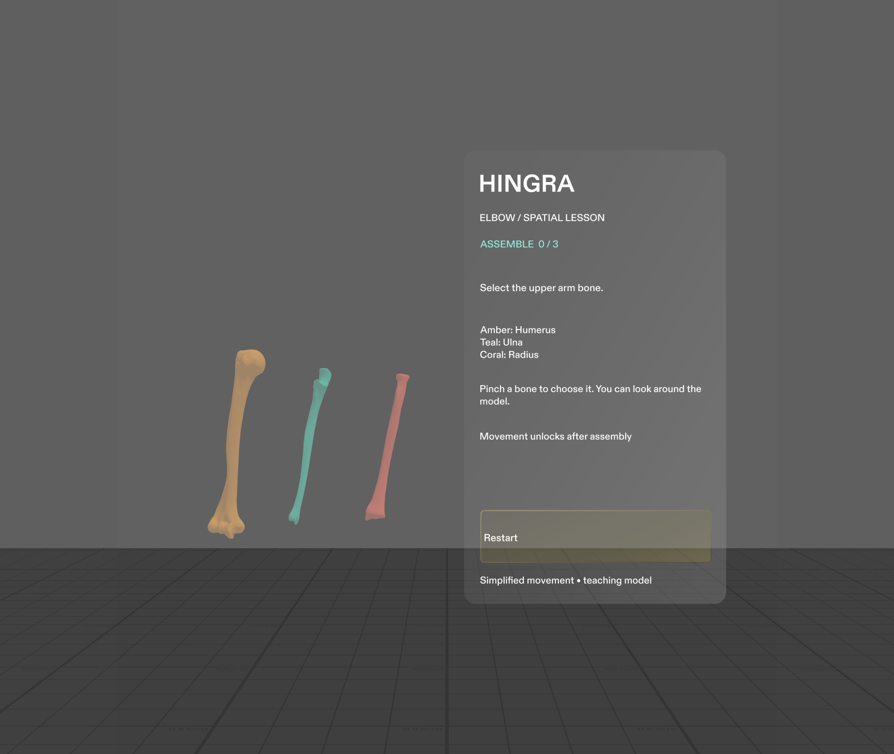

# Hingra

A native SPECS anatomy lesson: assemble a right elbow, explore its movement, then recognize the bones without colour cues.



## Open and play

1. Clone or download this repository. It includes the native scene, source meshes, audio, material, and package files.
2. Open `Hingra.esproj` in **Lens Studio 5.23.2**. Allow the initial package and TypeScript import to finish.
3. Set Preview to **SPECS 27 → Interactive → Plane**. Click the Preview reset button if needed.
4. Aim at a bone and click to select it; on SPECS, use standard SIK ray/pinch input.
5. Choose the humerus, ulna, and radius in the requested order. Wrong selections give feedback and leave the step unchanged.
6. Drag the slider to bend the assembled forearm. Choose **Test recall**, answer three prompts, then **Restart**.

Use WASD to move in Interactive Preview, Q/E to change height, and right-drag or Shift to look around. No physical glasses are required to try the preview.

## What is spatial

The lesson keeps a three-dimensional elbow in the learner's space. Selected bones move from a tray into their anatomical relationship. The radius and ulna then move together around an approximate elbow pivot while the humerus stays fixed. Recall shuffles the bones and removes their teaching colours.

The model is approximately 30 cm tall, placed about 110 cm in front of the initial viewpoint. Controls use standard Spectacles Interaction Kit and Spectacles UI Kit components.

## Implementation

- `Assets/Scene.scene`: native scene and typed component wiring.
- `Assets/Scripts/HingraState.ts`: single lesson state owner.
- `HingraMain.ts`: connects state, passive UI, anatomy, and sound.
- `HingraAnatomyController.ts`: native mesh animation, colliders, and SIK selections.
- `HingraLessonUI.ts`: UIKit panel, slider, and action button.
- `Hingra*Scenario.ts`: LEAF scenarios that drive real interaction controls.
- `devpost/`: design brief, implementation plan, asset provenance, and validation notes.
- `source-assets/bodyparts3d/`: the three original licensed OBJ files.

Built with Lens Studio 5.23.2, TypeScript, Spectacles Interaction Kit, Spectacles UI Kit, and LEAF 2.0.2. This version uses the `SpectaclesInteractionKit.lspkg` / `SpectaclesUIKit.lspkg` package names. Preserve the bundled versions when opening the project.

CLAD and the Lens Studio MCP tools were used to inspect APIs, import assets, author the native scene, and verify the preview. Visible anatomy uses licensed source geometry.

## Validation

Run the pure state checks with Node 24 or later:

```sh
node --experimental-strip-types --test tests/lesson-state.test.mjs
```

For interaction tests, open the LEAF panel in Lens Studio and run each registered Hingra scenario separately. Results and limitations are recorded in `devpost/validation.md`.

## Anatomy and scope

BodyParts3D, © The Database Center for Life Science licensed under CC Attribution 4.0 International.

The humerus, radius, and ulna come from the official BodyParts3D 4.0 reduced OBJ archive. The project converts axes, scales and recentres the source meshes, adds teaching colours, and animates an approximate single-axis pivot. See [THIRD_PARTY_NOTICES.md](THIRD_PARTY_NOTICES.md) and `devpost/anatomy-assets.json`.

This is a simplified teaching model. It does not align to a person, measure motion, or provide clinical guidance. Preview tests establish software behaviour; comfort and hand tracking on physical SPECS remain untested.

## Licence

Original Hingra code and generated sounds are MIT licensed. BodyParts3D geometry is CC BY 4.0. Bundled Snap packages retain their respective licences and terms.
